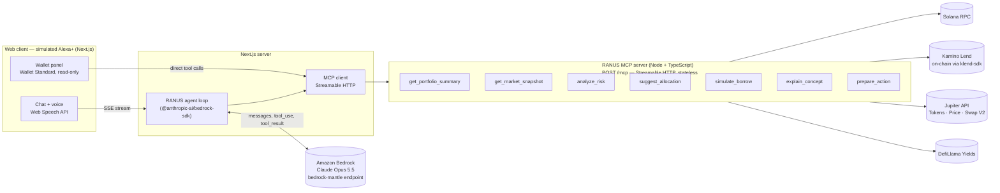

# RANUS — Autonomous Dollar & Asset Intelligence Agent

> **Amazon Developer Hackathon — Build, Ship, Shape**
> **Track:** Alexa+ · **Mini-challenge:** AWS Builder

RANUS is a voice-first, Alexa+-style agent that monitors, analyzes, explains and prepares actions on **real** digital dollars, yields and tokenized assets on Solana. It is built for people in emerging markets who want stable value and access to global assets — U.S.-dollar stablecoins, tokenized U.S. Treasuries and tokenized stocks — without needing to be DeFi experts.

Ask *"What's the safest way to hold my dollars right now?"* and RANUS will read your actual wallet, pull live lending rates from Kamino on-chain, live Treasury yields and prices, reason across them with **Claude on Amazon Bedrock**, and answer in plain language — showing every tool call and every live number it used.

**There is no mock data anywhere in RANUS.** Every balance, price, APY, LTV and quote comes from a live source at request time. If a source is unavailable, RANUS says so (or uses another *live* source) — it never fills the gap with estimates.

---

## Contents

- [What it does](#what-it-does)
- [Architecture](#architecture)
- [Quick start (local)](#quick-start-local)
- [API keys, AWS access and wallet connection](#api-keys-aws-access-and-wallet-connection)
- [The MCP server and its real data sources](#the-mcp-server-and-its-real-data-sources)
- [How Amazon Bedrock is used](#how-amazon-bedrock-is-used)
- [The web client (simulated Alexa+)](#the-web-client-simulated-alexa)
- [Verify the live data yourself](#verify-the-live-data-yourself)
- [No-mock-data policy](#no-mock-data-policy)
- [Project structure](#project-structure)
- [Track & mini-challenge](#track--mini-challenge)
- [Product feedback](#product-feedback)
- [Friction log](#friction-log)
- [Demo video script](#demo-video-script)

---

## What it does

| Capability | What RANUS does with live data |
|---|---|
| **Portfolio intelligence** | Reads SOL, SPL and Token-2022 balances from Solana RPC, prices them (Jupiter, with Kamino's on-chain oracles as a live fallback), classifies holdings (digital dollars, tokenized Treasuries, tokenized stocks, SOL/LSTs, other), hides airdrop spam, and includes Kamino Lend deposits/borrows with live LTV. |
| **Risk & opportunity detection** | Liquidation distance on Kamino loans, interest-driven LTV drift at live borrow/supply rates, withdrawal-liquidity risk (reserve utilization), idle stablecoins and the yield they forgo at today's rates, stablecoin depegs on live prices, concentration, low SOL for fees, unverified tokens. |
| **Strategy advisor** | Safest ways to hold dollars now (Kamino reserves on-chain + Ondo USDY + other Solana protocols), borrow capacity with live collateral parameters and liquidation prices, cash vs. tokenized Treasuries vs. tokenized stocks with live yields and prices, risk-profile allocation using a published policy. |
| **Action preparation** | Real Jupiter swap quotes (min. received, price impact, route, fees) cross-checked against Kamino's on-chain oracle; Kamino deposit and borrow previews at live APYs with balance, fee, utilization and liquidation-buffer checks. **Preview only — RANUS never builds, signs or submits transactions.** |
| **Contextual education** | Explains APY vs APR, LTV & liquidation, utilization, depegs, tokenized Treasuries/stocks, liquid staking… using the user's own balances and live rates. |

### Demo path

1. **Connect** Phantom/Solflare/Backpack (read-only) or paste any public Solana address → the live wallet panel loads instantly.
2. **Ask** a complex question (type or tap the mic): *"What's the safest way to hold my dollars right now?"*
3. **Watch** Claude on Bedrock plan and call several MCP tools (cards show each call, its arguments, latency and the live data returned).
4. **Get** a spoken one-line answer plus a concise breakdown with numbers, sources and an as-of time.

---

## Architecture



- **The MCP server is the integration point.** It is a standalone Model Context Protocol server over **Streamable HTTP** (stateless, horizontally scalable, optional bearer auth, DNS-rebinding protection). Any MCP host — Alexa+, Claude, the MCP Inspector, or the included web client — can use it.
- **The agent** runs in the Next.js server: Claude on Amazon Bedrock receives the MCP tools as tool definitions, decides which to call (often several in parallel), RANUS executes them over MCP, feeds results back, and loops until Claude has an answer.
- **The browser** never sees credentials. It receives a stream of events (reasoning summary, tool calls, tool results, answer text) and renders them live.

---

## Quick start (local)

**Prerequisites:** Node.js ≥ 20.18 and npm; an AWS account with access to Claude in Amazon Bedrock (see below). Optional: a Solana wallet browser extension, a Jupiter API key, a private Solana RPC URL.

```bash
git clone <this repo> ranus && cd ranus
npm install
cp .env.example .env        # then fill in AWS auth (see next section)
npm run dev                 # starts the MCP server (:8787) and the web app (:3000)
```

Open **http://localhost:3000**, connect a wallet or paste a Solana address, and ask a question.

| Command | What it does |
|---|---|
| `npm run dev` | MCP server (watch mode) + Next.js dev server |
| `npm run build && npm start` | Production build of the web app + both servers |
| `npm run typecheck` | Type-checks both packages |
| `npm run smoke -- <WALLET>` | Calls every MCP tool over HTTP against live data (MCP server must be running) |
| `npm run call -w mcp-server -- <tool> '<json>'` | Calls one MCP tool and prints its JSON result |

The MCP server alone needs **no keys at all** — the wallet panel and live-yields panel work without AWS. Only the chat agent needs Bedrock.

---

## API keys, AWS access and wallet connection

All configuration lives in one `.env` at the repo root (see [`.env.example`](.env.example)). Secrets stay server-side; nothing is sent to the browser.

### Amazon Bedrock (required for chat)

1. In the AWS console open **Amazon Bedrock → Model access** and make sure your account can use **Claude Opus 5.5** (`anthropic.claude-opus-5-5`) in your region. If it isn't available to your account yet, set `BEDROCK_MODEL_ID=anthropic.claude-opus-4-8` (open to all Bedrock customers) — no code changes needed.
2. Authenticate with **one** of:
   - **Bedrock bearer token** — mint one with AWS's `aws-bedrock-token-generator` and set `AWS_BEARER_TOKEN_BEDROCK`.
   - **IAM credentials** — `AWS_ACCESS_KEY_ID` / `AWS_SECRET_ACCESS_KEY` (+ `AWS_SESSION_TOKEN` for temporary creds) for a principal allowed `bedrock-mantle:CreateInference` on the model.
   - **AWS profile / SSO** — set `AWS_PROFILE` (or rely on the default credential chain).
3. Set `AWS_REGION` (default `us-east-1`; Claude in Amazon Bedrock is available in many regions).

The top bar shows the configured model/region and whether the MCP server is connected. Auth or model-access problems are shown in the chat with a precise fix.

### Live data sources (no keys required)

| Variable | Default | Notes |
|---|---|---|
| `SOLANA_RPC_URL` | `https://api.mainnet-beta.solana.com` | Public RPC works but is rate-limited; a free Helius/Triton/QuickNode URL makes demos snappier. |
| `JUPITER_API_KEY` | *(unset)* | Keyless `api.jup.ag` allows 0.5 req/s; RANUS batches and caches to stay within it. A free key from [developers.jup.ag/portal](https://developers.jup.ag/portal) doubles it. |
| `DEFILLAMA_YIELDS_URL` | `https://yields.llama.fi/pools` | Free, no key. |
| `KAMINO_MARKET` | `7u3HeH…v5PfF` | Kamino Lend main market. |

### Wallet connection

- **Connect** uses the [Wallet Standard](https://github.com/wallet-standard/wallet-standard), so Phantom, Solflare, Backpack and other Solana wallets appear automatically. RANUS only reads the **public address** — it never requests a signature or a private key.
- **Or paste any public address** (useful for judges: try your own wallet or any address you'd like to analyze).

---

## The MCP server and its real data sources

`mcp-server/` — TypeScript + Node.js, `@modelcontextprotocol/sdk` (`McpServer`, `StreamableHTTPServerTransport`), zod-validated input schemas, read-only tool annotations, and MCP-level errors (`isError`) whenever a live source fails.

- Endpoint: `POST http://127.0.0.1:8787/mcp` (stateless Streamable HTTP; `GET /health` for status)
- Inspect it: `npx @modelcontextprotocol/inspector` → Transport *Streamable HTTP* → URL above.
- Optional auth: set `RANUS_MCP_TOKEN` to require `Authorization: Bearer <token>`.

### Tools

| Tool | What it returns | Live sources |
|---|---|---|
| `get_portfolio_summary(wallet)` | Net worth, holdings with USD values, allocation by asset class, Kamino positions (deposits, borrows, LTV, liquidation distance), hidden-spam count, sources and warnings | Solana RPC, Jupiter Tokens V2, Kamino on-chain |
| `get_market_snapshot(sections?)` | Dollar yields (Kamino stablecoin reserves on-chain + other Solana protocols), Ondo USDY APY & price, tokenized stocks with prices, SOL price & LST yields | Kamino on-chain, DefiLlama, Jupiter |
| `analyze_risk(wallet)` | Severity-ranked findings with evidence: liquidation risk, interest-driven LTV drift, withdrawal liquidity, idle dollars & forgone yield, depegs, concentration, fee SOL, spam tokens | Solana RPC, Kamino on-chain, Jupiter |
| `suggest_allocation(wallet?, amountUsd?, riskProfile)` | Buckets (cash buffer, stablecoin lending, tokenized Treasuries, LSTs, tokenized stocks) filled with live products, live APYs and projected annual income vs. idle | Kamino on-chain, DefiLlama, Jupiter |
| `simulate_borrow(collateral, collateralAmount?, borrow, borrowAmount?, wallet?)` | Max borrow, scenarios with LTV, liquidation price, collateral drop to liquidation, interest cost; combines an existing Kamino loan | Kamino on-chain (oracle price, LTVs, borrow factor, borrow APY, liquidity) |
| `explain_concept(concept, wallet?)` | Plain-language explanation plus live numbers and sentences personalized with the user's balances | Kamino on-chain, DefiLlama, Jupiter, Solana RPC |
| `prepare_action(action, inputToken, outputToken?, amount, slippageBps?, wallet?)` | `swap`: real Jupiter quote + oracle cross-check; `kamino_deposit` / `kamino_borrow`: live-rate previews; balance/fee/risk checks; confirmation steps. **Never executes.** | Jupiter Swap V2, Kamino on-chain, Solana RPC |

### Data sources in detail

| Source | How RANUS uses it | Why this source |
|---|---|---|
| **Solana JSON-RPC** | `getBalance`, `getTokenAccountsByOwner` (SPL Token + Token-2022, `jsonParsed`), mint accounts for decimals, Token-2022 metadata extensions and Metaplex metadata for token names when Jupiter is unavailable | Ground truth for balances |
| **Kamino Lend** (official [`@kamino-finance/klend-sdk`](https://www.npmjs.com/package/@kamino-finance/klend-sdk), on-chain) | Loads every reserve of the main market from chain: supply/borrow APY, utilization, max LTV, liquidation LTV, borrow factor, available liquidity, deposit/borrow caps, **oracle prices**; reads the user's obligations (loans) refreshed at the current slot | Real lending rates and real liquidation math, straight from the protocol's state |
| **Jupiter API** — [Tokens V2](https://developers.jup.ag), Price V3, Swap V2 `/order` | Token metadata, verification, USD prices and 24h change (≤100 mints per call); the `stocks` tag for tokenized stocks (xStocks); real swap quotes (no `taker`, so no transaction is built) | Best on-chain price discovery and routing on Solana |
| **DefiLlama Yields** | Ondo **USDY** APY (tokenized short-term Treasuries), Solana liquid-staking APYs, and a cross-protocol view of Solana stablecoin yields | Public, protocol-agnostic yield aggregator; Ondo has no simple public APY API |

Rate limits are respected with a request queue (Jupiter keyless = 0.5 RPS), short TTL caches (prices 20–60 s, Kamino market 30 s, DefiLlama 10 min) and in-flight de-duplication. Only data that was actually fetched is ever cached.

### Allocation policy (transparent)

`suggest_allocation` uses fixed, published weights — the *policy* — and fills each bucket with *live* products chosen by safety rules (Kamino stablecoin reserves with ≥ $20M supply, < 95% utilization and no deposit cap; highest-TVL LST; an index-fund tokenized stock):

| Profile | Cash buffer | Stablecoin lending | Tokenized Treasuries | Liquid-staked SOL | Tokenized stocks |
|---|---|---|---|---|---|
| Conservative | 10% | 55% | 35% | 0% | 0% |
| Balanced | 10% | 40% | 25% | 15% | 10% |
| Growth | 5% | 25% | 10% | 30% | 30% |

If a bucket's live data is unavailable, its weight is moved to a safer bucket and the response says so explicitly.

---

## How Amazon Bedrock is used

Amazon Bedrock powers all of RANUS's reasoning and tool calling (`web/lib/agent.ts`):

- **Endpoint & SDK:** Claude in Amazon Bedrock's Messages API (`https://bedrock-mantle.{region}.api.aws/anthropic/v1/messages`) through Anthropic's official **`AnthropicBedrockMantle`** client from `@anthropic-ai/bedrock-sdk`, with SigV4 or Bedrock bearer-token auth.
- **Model:** `anthropic.claude-opus-5-5` by default (configurable).
- **MCP → Bedrock tools:** at the start of each turn the agent lists the RANUS MCP server's tools and passes their JSON Schemas to Bedrock as tool definitions.
- **Multi-step agent loop:** Claude decides which tools to call; RANUS executes all of a step's `tool_use` blocks **in parallel** over MCP, returns every `tool_result` in one message, and repeats (up to `RANUS_MAX_STEPS`, with a forced final answer at the cap).
- **Adaptive thinking** with `display: "summarized"` — the reasoning summary streams into the UI so judges can see the plan.
- **Effort control** via `output_config.effort` (`RANUS_EFFORT`, default `medium`) to trade depth vs. latency for voice.
- **Streaming** (SSE) end-to-end: Bedrock → Next.js route → browser.
- **Prompt caching** with explicit cache breakpoints (after the stable tools + system prompt, and on the newest message) so each agent step re-reads the conversation from cache.
- **Refusal fallback:** the SDK's client-side `betaRefusalFallbackMiddleware` retries on `anthropic.claude-opus-4-8` if the primary model declines on policy grounds (`BEDROCK_FALLBACK_MODEL_ID`, `none` to disable).
- **Grounding rules** in the system prompt: every number must come from a tool result in the conversation; missing data must be disclosed, never estimated.

---

## The web client (simulated Alexa+)

`web/` — Next.js 16 (App Router) + React 19. The Alexa+ track explicitly allows a web app that simulates the Alexa+ client; RANUS's is voice-first:

- **Voice in/out:** push-to-talk speech recognition and spoken replies (Web Speech API; best in Chrome/Edge). Answers start with a one- or two-sentence spoken summary, followed by details.
- **Visible tool use:** every MCP call appears as a card — tool name, arguments, latency, data age, a compact visualization (allocation bars, risk findings, borrow scenarios, quote checks) and the raw live JSON.
- **Live side panels:** the wallet panel and the "live dollar yields" panel call MCP tools directly (no LLM) and refresh on demand / every minute.
- Read-only by design, responsive down to phone width, keyboard accessible, reduced-motion aware.

---

## Verify the live data yourself

With the MCP server running (`npm run dev`):

```bash
# Every tool, end-to-end over MCP Streamable HTTP, against live sources:
npm run smoke -- <ANY_SOLANA_WALLET_ADDRESS>

# One tool:
npm run call -w mcp-server -- simulate_borrow '{"collateral":"SOL","collateralAmount":10,"borrow":"USDC"}'
npm run call -w mcp-server -- get_market_snapshot '{"sections":["dollar_yields","tokenized_treasuries"]}'
```

Each result carries `asOf` (and a Solana `slot` where relevant) plus `sources` and `warnings`, so you can cross-check numbers against [app.kamino.finance](https://app.kamino.finance), [jup.ag](https://jup.ag) or [solscan.io](https://solscan.io).

---

## No-mock-data policy

- No fixtures, sample wallets, hard-coded prices, yields or balances exist in the codebase. The only static data is reference *identifiers* (mint addresses of well-known stablecoins/LSTs/USDY, verified on-chain) and the published allocation-policy weights.
- When a source fails, tools return an MCP error or a `warnings`/`dataErrors` entry. Where a second **live** source exists it is used and labeled (e.g. Kamino's on-chain oracle price instead of Jupiter's price); otherwise the value is reported as unavailable.
- The agent is instructed to state only numbers present in tool results and to surface missing data.
- Unpriceable or unverified tokens are hidden from totals (and counted) rather than valued.

### Security notes

- RANUS is read-only: no private keys, no signing, no transaction submission. Wallet connection shares only a public address.
- AWS and API credentials are read server-side from `.env` and never reach the browser.
- The web app is designed to run locally. If you deploy it, put authentication in front of it — `/api/chat` spends your Bedrock quota.
- When exposing the MCP server beyond localhost, set `RANUS_MCP_TOKEN` (bearer auth) and bind `RANUS_MCP_HOST` deliberately; on localhost it applies DNS-rebinding protection automatically.

---

## Project structure

```
ranus/
├── .env.example            # all configuration, documented
├── mcp-server/             # RANUS MCP server (Streamable HTTP)
│   └── src/
│       ├── index.ts        # Express app, /mcp (stateless), /health, bearer auth
│       ├── server.ts       # McpServer + tool registration
│       ├── sources/        # live data: solana, kamino, jupiter, defillama, portfolio, markets, tokens, registry
│       ├── tools/          # the 7 MCP tools
│       ├── lib/            # fetch w/ retries, TTL cache + rate limiter, formatting
│       └── scripts/        # smoke test + single-tool CLI
├── web/                    # Next.js Alexa+-style client + Bedrock agent
│   ├── app/api/chat        # SSE: runs the Bedrock agent loop
│   ├── app/api/tools       # direct MCP calls for the live panels
│   ├── app/api/status      # MCP + Bedrock configuration status
│   ├── lib/agent.ts        # Bedrock (AnthropicBedrockMantle) multi-step tool loop
│   ├── lib/mcp.ts          # MCP client (Streamable HTTP)
│   └── components/         # chat, tool cards, wallet & market panels, voice
└── docs/
    ├── DEMO_SCRIPT.md
    └── FRICTION_LOG.md
```

---

## Track & mini-challenge

- **Primary track — Alexa+:** RANUS exposes its capabilities as a standards-based MCP server over Streamable HTTP (the integration surface for Alexa+-style multi-agent hosts) and ships a voice-first simulated Alexa+ client.
- **Mini-challenge — AWS Builder:** Amazon Bedrock (Claude in Amazon Bedrock) is the core reasoning and tool-calling engine; all model traffic is AWS-native (SigV4/IAM or Bedrock bearer tokens).

---

## Product feedback

What worked well and what we'd improve, from building RANUS:

**Amazon Bedrock (Claude in Amazon Bedrock)**
- 👍 The Messages-API endpoint (`bedrock-mantle`) uses the same request shape as Anthropic's first-party API, so tools, adaptive thinking, effort, streaming and prompt caching all go through one client (`AnthropicBedrockMantle`) with no request translation.
- 👍 Bearer-token auth makes local hackathon setups much easier than IAM wiring.
- 🔧 Model access differs per model (Opus 5.5 gated, Opus 4.8 open). A single "which models can this principal call?" API on the Mantle endpoint would let apps pick a model automatically.
- 🔧 Docs for the legacy (`InvokeModel`/Converse) and Messages-API integrations live side-by-side; it's easy to land on the legacy page and its feature table first.

**Model Context Protocol**
- 👍 Stateless Streamable HTTP + zod schemas make a server that any host can use, and the same server powers both the agent and the UI panels.
- 🔧 Tool schemas generated from zod include a `$schema` key that we strip before handing them to the model; a standard "LLM-ready schema" export would help.

**Solana data providers**
- 👍 Kamino's SDK exposes the real risk math (borrow factor, liquidation LTV, refreshed obligation stats) — far better than re-implementing it.
- 🔧 `@kamino-finance/klend-sdk@13.0.2` requires `@solana-program/memo` and `dotenv` at runtime without declaring them, and peer-ranges pin `@solana/kit` 2.x; we pinned compatible versions.
- 🔧 Jupiter's keyless tier (0.5 RPS) is generous for demos but needs client-side queuing; rate-limit headers made backoff straightforward.
- 🔧 There's no simple public on-chain or REST APY feed for Ondo USDY; we rely on DefiLlama's aggregation.

**Alexa+ track**
- 🔧 A public sandbox Alexa+ host that can attach a remote MCP server would let teams demo the real device flow rather than a simulated client.

---

## Friction log

A filled-in log and a reusable template are in [`docs/FRICTION_LOG.md`](docs/FRICTION_LOG.md).

## Demo video script

A < 3 minute script that shows real data end-to-end is in [`docs/DEMO_SCRIPT.md`](docs/DEMO_SCRIPT.md).

---

*RANUS provides information, not financial advice. It is read-only: it never holds keys, signs, or submits transactions.*
